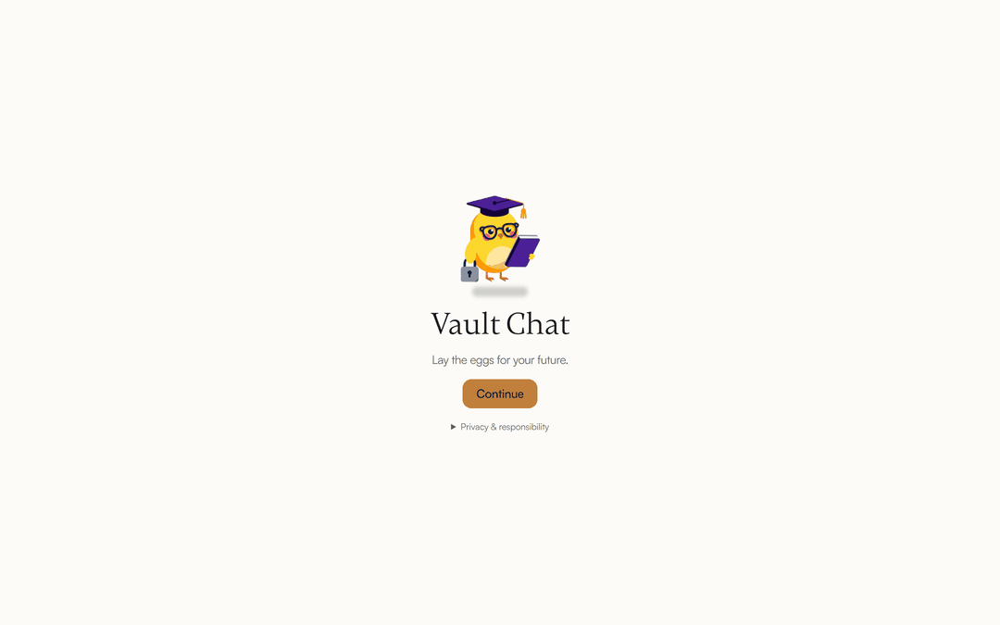
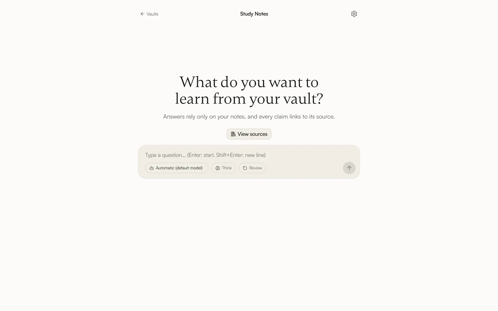
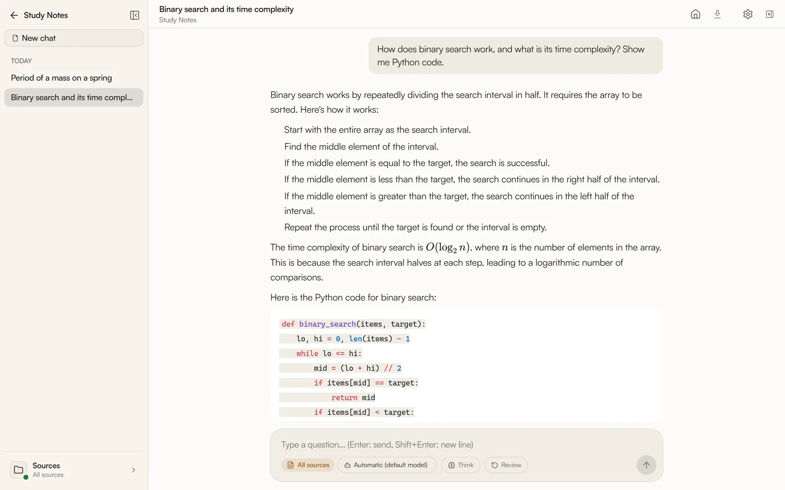
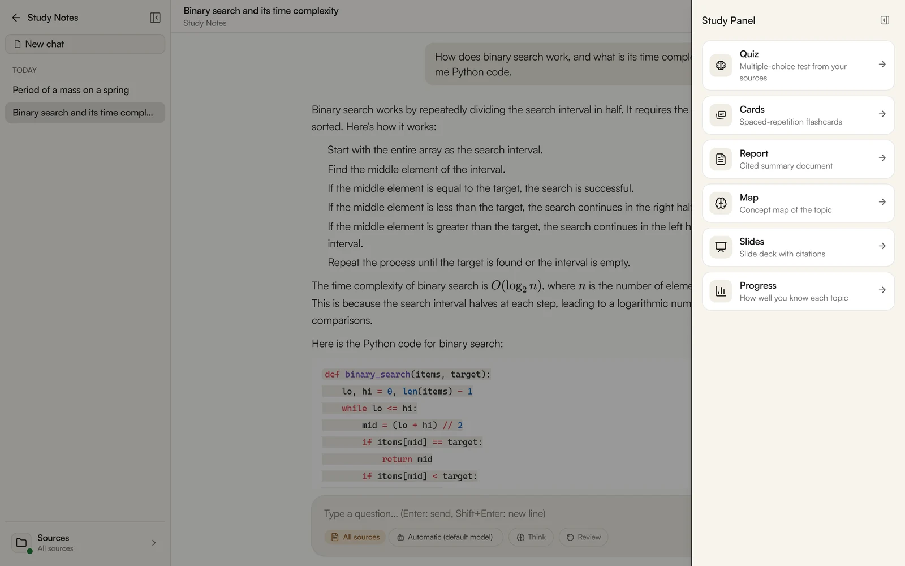
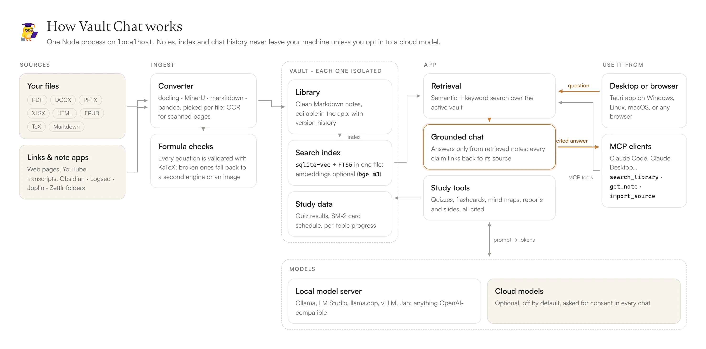

<p align="center">
  
</p>

<h1 align="center">Vault Chat</h1>

<p align="center">
  <b>Kendi notlarınla konuşan, yerelde çalışan bir çalışma asistanı.</b><br />
  Belgelerini içe aktar, sorularına kaynak göstererek cevap alsın; aynı kaynaklardan test, kart, rapor ve slayt üretsin.
</p>

<p align="center">
  
  
  
  
  
  
  
</p>

<p align="center">
  
</p>

## Ne yapar?

- **Kaynağa dayalı sohbet (RAG).** Cevaplar yalnızca kasandaki notlardan gelir; her cevabın altında hangi notun hangi bölümünün kullanıldığı görünür. Formüller KaTeX ile, kod sözdizimi renklendirmesiyle gösterilir.
- **Her türden kaynağı içe aktarır.** PDF, DOCX, PPTX, XLSX, HTML, EPUB, TeX ve Markdown dosyaları, ayrıca bağlantılar ve Obsidian/Logseq/Joplin/Zettlr klasörleri Markdown'a dönüştürülüp kütüphaneye eklenir. Formül yoğun PDF'ler için docling ve MinerU yedekli bir hat kullanılır.
- **Çalışma araçları.** Aynı kaynaklardan çoktan seçmeli test, SM-2 aralıklı tekrar kartları, kavram haritası, atıflı rapor ve slayt üretir; ilerlemeni konu konu izler.
- **Birden fazla kasa.** Her kasanın kendi kütüphanesi ve arama indeksi vardır, birbirine karışmaz.
- **Yerel öncelikli.** Varsayılan yol Ollama ya da OpenAI uyumlu herhangi bir yerel sunucudur (LM Studio, llama.cpp, vLLM, Jan). Bulut sağlayıcılar isteğe bağlıdır, varsayılan olarak kapalıdır ve her sohbette ayrıca onay ister.
- **MCP sunucusu.** Claude Code/Desktop gibi MCP istemcileri kasanda arama yapabilir, not okuyabilir ve kaynak içe aktarabilir; içe aktarma, uygulamada onaylayınca (ya da kasa için otomatik onayı açarsan) kütüphaneye girer.
- **16 arayüz dili**, açık/koyu ve sıcak tonlu temalar, masaüstü paketi (Tauri) ya da tarayıcıdan kullanım.

## Ekran görüntüleri

<table>
  <tr>
    <td width="50%">
      <picture>
        <source media="(prefers-color-scheme: dark)" srcset="docs/assets/screenshots/home-dark.webp" />
        
      </picture>
      <p align="center"><sub>Kasa ana ekranı (açık ve koyu tema)</sub></p>
    </td>
    <td width="50%">
      
      <p align="center"><sub>Kaynak çipli cevap: kod ve formül birlikte</sub></p>
    </td>
  </tr>
  <tr>
    <td width="50%">
      
      <p align="center"><sub>Çalışma paneli: test, kart, rapor, harita, slayt</sub></p>
    </td>
    <td width="50%">
      
      <p align="center"><sub>Kaynak görüntüleyici: düzenleme ve önceki sürümler</sub></p>
    </td>
  </tr>
</table>

<sub>Görüntüler, örnek notlardan oluşan bir demo kasasında yerel <code>qwen3:8b</code> modeliyle, İngilizce arayüzde alındı.</sub>

## Nasıl çalışır?

<picture>
  <source media="(prefers-color-scheme: dark)" srcset="docs/assets/architecture-dark.webp" />
  
</picture>

Her şey tek bir Node sürecinde, `localhost`'ta çalışır. Docker ya da harici bir sunucu gerekmez. Notların, indeksin ve sohbet geçmişin kendi makinende kalır.

## Hızlı başlangıç

```bash
git clone https://github.com/KodAlp/vault-chat.git
cd vault-chat
npm install
npm run dev
```

Ardından `http://localhost:5173` adresini aç. İlk açılıştaki kurulum sihirbazı yerel model sunucusunu bulur ve sohbet ile embedding modelini seçmene yardım eder. Ön koşullar (Node.js 22 ve bir model kaynağı), masaüstü paketi, MCP kurulumu ve sorun giderme aşağıdaki ayrıntılı bölümlerde.

Katkıda bulunmak için [`CONTRIBUTING.md`](CONTRIBUTING.md); gizlilik, güvenlik ve kullanım koşulları için [`PRIVACY.md`](PRIVACY.md), [`SECURITY.md`](SECURITY.md) ve [`TERMS.md`](TERMS.md). Proje MIT lisanslıdır ([`LICENSE`](LICENSE)).

---

# Ayrıntılı kurulum

Yerel, Docker'sız bir SvelteKit çalışma/sohbet uygulaması. Kendi kütüphanendeki
notlar ve belgeler üzerinde RAG yapar; yerel bir model sunucusuyla (Ollama önerilir ama zorunlu değil —
LM Studio, llama.cpp, vLLM, Jan gibi herhangi bir OpenAI uyumlu sunucu da olur)
ya da isteğe bağlı bir bulut sağlayıcıyla konuşur. Tek Node süreci,
`localhost`'a bağlı.

## Ön koşullar

1. **Node.js 22** (`>=22 <23`; 20 ve 24 çalışmaz — kurulu sürümü `node --version` ile gör).
2. **Bir sohbet modeli kaynağı** — **Ollama önerilir** (https://ollama.com), ama
   zorunlu değil. Şunlardan biri yeter:
   - Ollama,
   - OpenAI uyumlu başka bir yerel sunucu: llama.cpp, LM Studio, vLLM, Jan,
     LocalAI,
   - bir bulut sağlayıcı (DeepSeek, Google AI Studio, OpenRouter...; isteğe bağlı,
     varsayılan kapalı, bkz. `PRIVACY.md`).

   Hiçbiri kurulu değilse sohbet çalışmaz: uygulama "Kurulum tamamlanmadı"
   uyarısı gösterir.
3. **Embedding (arama) modeli — isteğe bağlı.** Embedding destekleyen herhangi
   bir sağlayıcı olur; hiç seçmezsen arama yalnızca anahtar kelimeyle (FTS)
   çalışır, anlamsal arama kapalı olur. Ollama kullanıyorsan önerilen model
   `bge-m3` — `nomic-embed-text` DEĞİL (`src/lib/server/embed-config.ts`'teki
   `EMBED_MODEL`; Türkçe sorgularda ölçülebilir şekilde daha iyi sonuç veriyor,
   gerekçe embed-config.ts'in kendi yorumunda). Embedding yapılandırdığın bir
   modeli sunucuda çekmezsen `npm run index` "model not found" ile patlar.

**Ana yol: kurulum sihirbazı.** İlk açılışta (masaüstü paketinde) ya da
tarayıcıda `/setup/local-server` adresinden, ayrıca **Ayarlar → Sağlayıcılar**
sayfasındaki "Kurulum sihirbazını yeniden çalıştır" bağlantısından açılır ve üç
adımda ilerler: (1) yerel sunucuyu bul/kur, (2) sohbet modelini seç, (3)
embedding modelini seç **ya da "yalnızca anahtar kelime araması"nı** seç. Elle
yapmak istersen Ollama için:
```bash
ollama serve
ollama pull qwen3:8b      # önerilen sohbet modeli
ollama pull bge-m3        # önerilen embedding modeli (isteğe bağlı)
# isteğe bağlı, derin oturumlar için:
ollama pull qwen3:30b-a3b
```

Bu maddeleri elle kontrol etmek yerine tek komutla doğrulamak için:
```bash
npm run doctor
```

## Kurulum

```bash
cd vault-chat
npm install
```

`.env` dosyası zaten `.env.example`'dan oluşturuldu. Gerekirse aç ve kontrol et:

```
CHATS_DB_PATH=./data/chats.db
PUBLIC_VAULT_NAME=Notlarım   # "default" vault'un ilk açılıştaki görünen adı
```

`OLLAMA_URL` artık okunmuyor: Ollama'nın (ve diğer sunucuların) adresi
Ayarlar → Sağlayıcılar'dan, yani `providers.json`'daki `baseUrl` alanından
ayarlanır.

`PUBLIC_VAULT_NAME` yalnızca "default" vault ilk oluşturulurken (bkz.
`migrateVaults.ts`) varsayılan görünen ad olarak okunur — sonraki
çalıştırmalarda etkisi yok. Kaynaklar her zaman uygulamanın kendi
görüntüleyicisinde açılır. Obsidian, Logseq, Joplin, Zettlr gibi not
uygulamalarından gelen Markdown klasörleri yalnızca birer içe aktarma
kaynağıdır (**Ayarlar → Kütüphane**).

`data/providers.json` bu repoyla birlikte gelen bir **tohum** dosya — yeni
bir kurulum bulut sağlayıcılardan (DeepSeek, Google AI Studio) bazılarını
`enabled: true` olarak bulur. Bunları gerçekten kullanmak yine de (a) o
sağlayıcı için `data/secrets.json`'a bir API anahtarı girmenizi (Ayarlar →
Sağlayıcılar) ve (b) her sohbette ayrı bir onay kutusunu kabul etmenizi
gerektirir (bkz. `PRIVACY.md`) — yalnızca `enabled: true` olması hiçbir
veri göndermez. Bulut sağlayıcıları arayüzde seçenek olarak dahi görmek
istemiyorsanız, kendi `data/providers.json`'ınızda ilgili girdiyi
`enabled: false` yapabilirsiniz. Paketli masaüstü sürümü ise bu dosyayı değil,
temiz bir varsayılan olan `data/providers.default.json`'ı tohum olarak
kullanır: tüm bulut sağlayıcılar kapalı, görev zincirleri boş, embedding yok
(yalnızca anahtar kelime araması) — kurulum sihirbazı bunları doldurur.

## Vault'lar (Faz 8)

Uygulama tek bir kütüphane yerine **birden fazla vault** tutabilir — her biri
kendi kaynak klasörü ve arama indeksiyle, birbirinden tamamen izole
(`data/vaults/<id>/library/`, `data/vaults/<id>/index.db`). Sohbet geçmişi tek
bir global DB'de kalır (`data/chats.db`), her sohbet hangi vault'a ait olduğunu
kaydeder.

- Vault oluşturmak/silmek/yeniden adlandırmak için **Ayarlar → Vault'lar**.
- Bir defada tek bir vault "aktif" — sohbet ekranı ve indeksleyici hep aktif
  vault üzerinde çalışır.
- **Eski (Faz 8 öncesi) bir kurulumdan geliyorsan** hiçbir şey yapmana gerek
  yok — sunucu ilk açılışta `data/vaults.json` bulunmadığını görüp
  `LIBRARY_PATH`/`INDEX_DB_PATH`/`STUDY_DB_PATH` içeriğini otomatik olarak
  `data/vaults/default/` altına taşır ve "default" adında bir vault kaydeder;
  eski sohbetlerin hepsi bu vault'a bağlanır. **`VAULT_PATH` bilerek
  taşınmaz** — Faz 5 öncesi mimaride bu, canlı bir Markdown not klasörünü
  (örn. bir Obsidian vault'unu) yerinde gösteren bir işaretçiydi (hiç kopyalanmazdı), app'e ait bir klasör değil.
  Sadece `VAULT_PATH` ayarlıysa (bu repodaki gibi — `data/library` boş,
  gerçek içerik `VAULT_PATH=..`'den yerinde indeksleniyor) "default" vault
  **boş** başlar; içeriği Ayarlar → Kütüphane'deki içe aktarma ile
  elle (yeniden) içe aktarman gerekir. Bunu elle, önizlemeli çalıştırmak
  istersen:
  ```bash
  npm run vault:migrate -- --dry-run   # ne taşınacağını raporlar, hiçbir şey yazmaz
  npm run vault:migrate                # gerçekten taşır
  ```

## İlk indeksleme

Sohbet edebilmek için önce aktif vault'un içeriği vektör indeksine dönüşmeli:

```bash
npm run index
```

Bu, aktif vault'un kütüphanesindeki tüm `.md` dosyalarını tarar,
frontmatter'ı olmayanları uyarı ile atlar, geri kalanını parçalayıp
yapılandırılmış embedding modeliyle (önerilen: `bge-m3`) gömer ve o vault'un
`index.db`'sine yazar. Embedding yapılandırılmamışsa (yalnızca anahtar kelime
modu) vektör adımı atlanır; parçalar ve anahtar kelime (FTS) verisi yine yazılır. sha256
tabanlı artımlı çalışır — değişmeyen dosyaları atlar, `pdf2md.py` ile aynı mantık.

Bayraklar:
- `npm run index -- --vault <id>` — aktif vault yerine belirli bir vault'u
  indeksler (id, Ayarlar → Vault'lar'da görünen kimlik).
- `npm run index -- --full` — hepsini sıfırdan yeniden indeksler (embed modeli
  değiştiyse bunu kullan).
- `npm run index -- --dry-run` — hiçbir şey yazmadan neyin değişeceğini raporlar.

## Günlük kullanım

```bash
npm run dev
```

`http://localhost:5173` açılır. Ders çalışıp not güncelledikten sonra, istediğin
an `npm run index` çalıştır — uygulama açıkken bile çakışma olmaz (WAL modu).

Otomatik izleme istersen (opsiyonel, varsayılan değil):

```bash
npm run index:watch
```

## Kalıcı kullanım (geliştirme sunucusu olmadan)

```bash
npm run build
BODY_SIZE_LIMIT=1G node build
```

`BODY_SIZE_LIMIT` olmadan adapter-node istek gövdesini **512 KB** ile
sınırlar (kendi varsayılanı) ve bu boyutu aşan her kaynak yüklemesi, route'a
hiç ulaşmadan 413 ile reddedilir — küçük bir `.docx` geçer ama gerçek bir
`.pdf`/`.pptx`/`.xlsx` geçmez. Masaüstü paketinde bu değişken sidecar'a
otomatik veriliyor (`src-tauri/src/lib.rs`); `node build`'i elle
çalıştırırken sen vermelisin. Bu akış `.env` okumaz, ortam değişkeni olarak
geçmen gerekir.

## Masaüstü (Tauri)

Aynı sunucuyu tarayıcı yerine yerel bir pencerede çalıştıran, Electron
kullanmayan bir paket. Ön koşullar tarayıcı akışıyla birebir aynı — **Node.js
22 kurulu olmalı; sohbet için bir model kaynağı (önerilen: Ollama, ya da başka
bir yerel sunucu / bulut sağlayıcı) gerekir**, hiçbiri pakete gömülmez.

```bash
npm run desktop:dev      # canlı Vite dev sunucusuna karşı native pencere, HMR çalışır
npm run desktop:build    # çalıştığın işletim sisteminin paketini üretir
```

Windows'ta `desktop:build` çıktısı: `src-tauri/target/release/bundle/nsis/vault-chat_<sürüm>_x64-setup.exe`
(NSIS kurulum dosyası). Linux ve macOS paketleri aynı komutla, kendi işletim
sisteminde üretilir (çapraz derleme yok); hedefler `src-tauri/tauri.linux.conf.json`
(`deb`, `appimage`) ve `src-tauri/tauri.macos.conf.json`'da (`app`, `dmg`) — bkz.
aşağıdaki "Linux ve macOS (yeni, beta)" bölümü. Hazır paketler için GitHub
Actions'taki `desktop` iş akışı dört hedefi (Windows x64, Linux x64, macOS arm64,
macOS x64) derleyip her biri için `vault-chat-<hedef>` adlı bir artifact yükler
(`.github/workflows/desktop.yml`; artifact'lar 7 gün saklanır). İş akışı **yalnız
`ci` dalına push'ta** (ya da Actions sekmesinden elle "Run workflow" ile) çalışır;
`main`, özellik dalları ve PR'lar tetiklemez (Actions dakikaları sınırlı). Bir dalı
derletmek için: `git push origin <dal>:ci` (gerekirse `--force`).

Windows kurulum konumu ve veri klasörü:
Kurulum kullanıcı bazlı (yönetici gerektirmez), `%LOCALAPPDATA%\vault-chat\`
altına gider. Uygulama verisi (sohbet geçmişi, vault registry, her vault'un
kütüphanesi/indeksi, `config.json`) Windows'ta `%APPDATA%\Roaming\app.vaultchat.desktop\`
(macOS: `~/Library/Application Support/app.vaultchat.desktop/`, Linux:
`~/.local/share/app.vaultchat.desktop/`) altında tutulur — `data/` klasöründen tamamen ayrı, tarayıcı akışıyla
paylaşılmaz. Vault registry buradaki `DATA_DIR`'e göre çözülür (sidecar'ın
kendi ortam değişkeni, kullanıcının görmediği); `config.json`'daki tek
`vault_path`/`vault_name` çifti ise ayrı bir şey — ilk kurulan **"default"**
vault'un adını belirler, ek vault'lar sonradan uygulama içi Ayarlar → Vault'lar'dan
oluşturulur.

İlk açılışta bir klasör seçmen istenir (native klasör seçici) — bu, "default"
vault'un görünen adı için sorulur,
kütüphane içeriği oraya BAĞLANMAZ (kütüphane her zaman uygulamaya ait bir
klasördür, bkz. yukarıdaki "Vault'lar" bölümü). Seçim `config.json`'a yazılır
ve sonraki açılışlarda tekrar sorulmaz. Bu adı sonradan değiştirmek için
**Ayarlar → Masaüstü — Kasa Konumu** kullan (değişiklik bir sonraki
başlatmada etkili olur, çalışan sunucuyu yeniden başlatmaz).

`node build/index.js`'i doğrudan çağırdığından, kalıcı kullanım akışının
gerektirdiği her şey (Node 22, `.env` değil ortam değişkenleri) burada da
geçerli — bkz. yukarıdaki not.

## Başka bir Windows makinesinde çalıştırma

Ne installer ne de geliştirici kurulumu Node'u veya yerel model sunucusunu
(Ollama gibi) pakete gömüyor — Node hedef makinede **elle** kurulu olmalı, model
kaynağı da (önerilen Ollama, başka bir yerel sunucu ya da bir bulut sağlayıcı)
ayrıca ayarlanmalı. Hedef makinede kurulduktan sonra `npm run doctor`
(geliştirici akışı) ya da uygulamanın kendi "Yerel sunucu … çalışmıyor" /
"Kurulum tamamlanmadı" banner'ı (masaüstü paketi) eksik olanı söyler.

| Bileşen | Zorunlu mu | Kim kuruyor |
|---|---|---|
| Node.js 22.x (`>=22 <23`) | Evet, masaüstü paketinde de | Elle — https://nodejs.org |
| Ollama + `qwen3:8b` + `bge-m3` | **Önerilen** (başka yerel sunucu ya da bulut sağlayıcı da olur; embedding yoksa yalnızca anahtar kelime araması) | Elle — https://ollama.com, ya da kurulum sihirbazı |
| WebView2 Runtime | Evet (yalnızca masaüstü paketi) | Otomatik — NSIS installer yoksa internetten indirip kurar |
| Visual C++ Redistributable | Teknik olarak evet | Genelde Windows 10/11'de zaten var; eksikse elle |
| Python 3.12+ (kararlı sürüm) | Hayır — yalnızca PDF/doküman/YouTube içe aktarma için | Elle — https://python.org |
| `markitdown` paketi (`pip install -r ingest/requirements.txt`) | Hayır — yalnızca PDF/doküman/YouTube içe aktarma için | Elle, veya masaüstü paketinde uygulamanın kendi "Şimdi kur" banner'ı |
| pandoc | Hayır — yalnızca `.tex` dönüştürme için | Elle |

Dikkat edilecek noktalar:
- **ARM64 Windows desteklenmiyor.** `sqlite-vec`'in Windows için yalnızca
  `win32-x64` prebuilt paketi var — ARM tabanlı bir Windows makinesinde
  (Snapdragon vb.) `npm install` sqlite-vec için başarısız olur.
- **Yanlış Node sürümü sessizce kurulur, çalışma anında patlar.** `engine-strict`
  kapalı olduğu için `npm install` Node 20/24 ile de tamamlanır, ama
  `better-sqlite3`'ün native binary'si Node 22'nin ABI'sine derli — hata ancak
  ilk veritabanı erişiminde çıkar. `npm run doctor` bunu kurulumdan hemen
  sonra yakalar.
- **`secrets.json` taşınmaz.** Masaüstü paketinde AES-256-GCM ile
  şifrelenir; şifreleme anahtarı işletim sisteminin deposundadır (Windows
  DPAPI, macOS Keychain, Linux Secret Service) ve kullanıcı/makine profiline
  bağlıdır — başka bir makineye/kullanıcıya kopyalanan bir `secrets.json`
  çözülemez, "anahtar yok" gibi davranır. Bulut sağlayıcı (DeepSeek/Gemini/Groq/...) API anahtarlarını
  hedef makinede Ayarlar → Sağlayıcılar'dan yeniden gir.
- **Vault içerikleri elle taşınır.** `data/vaults.json` kendi yollarını her
  okumada yeniden türettiği için taşınabilir, ama her vault'un asıl içeriği
  (`data/vaults/<id>/library/`, `index.db`, `study.db`) ayrıca kopyalanmalı —
  ya da hedef makinede içe aktarma + `npm run index` ile
  yeniden oluşturulmalı.
- **Masaüstü paketinde PDF/doküman/YouTube içe aktarma, Python + markitdown
  hedef makinede kuruluysa çalışır.** `ingest/` klasörü kurulum paketine
  dahil (bkz. `scripts/stage-server.mjs`), ama Python'un kendisi ve
  `markitdown` paketi hâlâ elle kurulmalı (installer bunları gömmez — bkz.
  yukarıdaki tablo). Eksikse uygulama artık `/api/system/python` üzerinden
  bunu algılayıp turuncu bir banner'da "Şimdi kur" butonuyla
  `pip install -r ingest/requirements.txt`'i senin yerine çalıştırır.

## Linux ve macOS (yeni, beta)

> **Uyarı:** Linux ve macOS paketleri yeni. CI'da derleniyor ama **henüz gerçek
> bir Linux/macOS makinesinde denenmedi**; macOS paketi ayrıca **imzasız ve
> noter onaysız (notarize edilmemiş)**. Windows kadar olgun değil — sorun
> görürsen veri klasöründeki `launch.log`'u (aşağıda) ekleyerek bildir. macOS
> için adım adım deneme listesi: [`docs/macos-deneme-listesi.md`](docs/macos-deneme-listesi.md).

Desteklenen paket biçimleri (CI'da derlenir; bkz. "Masaüstü (Tauri)"):

| Platform | Paket | Not |
|---|---|---|
| Linux x64 | `.deb`, `.AppImage` | `.deb` şu paketlere bağlıdır: `libwebkit2gtk-4.1-0`, `libgtk-3-0`, `libayatana-appindicator3-1`, `libsecret-1-0` (`src-tauri/tauri.linux.conf.json`) |
| macOS (Apple Silicon ve Intel) | `vault-chat.app` + `.dmg`, imzasız | macOS 11.0 ve üstü (`minimumSystemVersion`) |

Kaynaktan derlemek için Linux'ta (CI'daki Ubuntu 22.04 paket listesi):
```bash
sudo apt-get install -y libwebkit2gtk-4.1-dev libayatana-appindicator3-dev \
  librsvg2-dev patchelf libsecret-1-dev libdbus-1-dev
npm install && npm run desktop:build
```

| Bileşen | Zorunlu mu | Linux / macOS'ta nasıl kurulur |
|---|---|---|
| Node.js 22.x (`>=22 <23`) | Evet — pakete gömülü değil | https://nodejs.org, Homebrew (`brew install node@22`), nvm/fnm/Volta veya dağıtımın paket yöneticisi |
| Model kaynağı (Ollama önerilir, başka yerel sunucu ya da bulut sağlayıcı) | Sohbet için bir tanesi | Elle — https://ollama.com |
| Python **3.10+** | Hayır — yalnızca PDF/doküman/YouTube içe aktarma için | macOS: `brew install python@3.12`; Linux: dağıtımın paket yöneticisi (Debian/Ubuntu'da `sudo apt install python3 python3-venv`) |
| pandoc | Hayır — yalnızca `.tex` dönüştürme için | Homebrew ya da dağıtımın paket yöneticisi |

Bilmen gerekenler:
- **Node nasıl bulunur?** GUI'den açılan uygulama kabuğunun PATH'ini
  devralmaz. Bu yüzden `node` önce PATH'te (oturum/login kabuğunun PATH'i dahil)
  ve sonra bilinen konumlarda aranır: `/usr/local/bin`, `/usr/bin`,
  `/opt/homebrew/bin`, `~/.volta/bin`, nvm (`~/.nvm/versions/node`) ve fnm
  sürüm klasörleri (`src-tauri/src/platform.rs`, `src-tauri/src/lib.rs`'teki
  `resolve_node_binary`). Bulunan Node'un ana sürümü 22 değilse uygulama
  açılışta uyarır.
- **Python "Şimdi kur"** macOS/Linux'ta sistem Python'una `pip install` yapmaz
  (Debian/Homebrew "externally managed" korumasına takılır). Bunun yerine veri
  klasöründe uygulamaya ait bir sanal ortam (`python-venv`) oluşturup paketleri
  oraya kurar (`src/routes/api/system/python/+server.ts`,
  `src/lib/server/python-bin.ts`). Debian/Ubuntu'da `python3-venv` paketi
  yoksa ortam oluşturulamaz ve uygulama bunu söyler. macOS'ta Komut Satırı
  Araçları (CLT) kurulu değilse `/usr/bin/python3` yer tutucusu atlanır
  (kurulum penceresi tetiklenmesin diye). `PYTHON_BIN` ortam değişkeniyle belirli
  bir yorumlayıcı da verilebilir.
- **winget yalnızca Windows'ta.** macOS/Linux'ta uygulama paket yöneticisini
  kendisi çalıştırmaz; Homebrew / dağıtım paket yöneticisi komutlarını sen
  çalıştırırsın.
- **API anahtarları** işletim sisteminin deposuyla korunur: macOS'ta
  Anahtar Zinciri (servis `app.vaultchat.desktop`, hesap `secrets-key`;
  ilk açılışta bir izin sorusu çıkabilir — "Her Zaman İzin Ver"), Linux'ta
  Secret Service (GNOME Keyring / KWallet). Linux'ta bu servis yoksa anahtarlar
  şifrelenmeden (`0600` izinli dosyada) saklanır ve Ayarlar → Sağlayıcılar'da
  bir uyarı görürsün; GNOME Keyring veya KWallet kurup uygulamayı yeniden
  başlatınca şifrelenir. Anahtar var ama okunamıyorsa ("kilitli") hiçbir şey
  yeniden üretilmez; **Ayarlar → Sağlayıcılar → "Kayıtlı API anahtarlarını
  sıfırla"** eski dosyayı `secrets.json.locked-<tarih>` olarak yedekleyip
  uygulamayı yeniden başlatır. Ayrıntı: `SECURITY.md`.
- **Arka plan süreçleri:** Linux'ta uygulama çökse bile işletim sistemi çekirdeği Node
  sunucusuna `SIGTERM` gönderir (`PR_SET_PDEATHSIG`). macOS'ta böyle bir
  güvence yok: yalnızca normal çıkışta (Cmd+Q) sunucu süreci temizlenir;
  uygulama çökerse ya da zorla sonlandırılırsa `node` süreci arkada kalabilir.
- **Günlük dosyası:** açılış sorunlarında `launch.log` — macOS:
  `~/Library/Application Support/app.vaultchat.desktop/launch.log`, Linux:
  `~/.local/share/app.vaultchat.desktop/launch.log`.

### macOS: imzasız uygulamayı açma (Gatekeeper)

Uygulama Apple tarafından imzalanmadığı ve noter onayından geçmediği için
macOS ilk açılışta engeller ("geliştirici doğrulanamadı" ya da "hasarlı").
`.dmg`'den `vault-chat`'i **Applications**'a sürükle, sonra Finder'da uygulamaya
**sağ tık → Aç → Aç** de. Yine açılmazsa karantina işaretini kaldır:

```bash
xattr -dr com.apple.quarantine /Applications/vault-chat.app
```

## MCP Sunucusu

Kasandaki notları Claude Code/Desktop gibi MCP istemcilerine açan yerel bir
sunucu — ayrı bir paket veya kurulum gerektirmez, `mcp/` bu repo'nun içinde
`indexer/` ile aynı desende yaşar.

**Araçlar:**

- `list_vaults` — MCP'ye açık kasaları listeler (kasa başına açma/kapama: **Ayarlar → Kasalar**).
- `search_library` — kasada arar; vektör araması, embedding yoksa ya da sonuç vermezse anahtar kelime (FTS5) yedeğiyle. `domain`/`level` süzgeci alır.
- `get_note` — bir notu okur.
- `list_sources` — kasadaki kaynakları, domain ve seviye değerleriyle listeler.
- `create_vault` — yeni kasa oluşturur.
- `import_source` — yerel dosya ya da URL'yi içe aktarmak üzere **bekleyenlere** ekler.
- `list_pending_imports` — bekleyen içe aktarmaların durumunu gösterir.
- `edit_note` — var olan bir notu düzenler (`get_note`'un `hash` değeri `expected_hash` olarak gerekir; frontmatter değişmez, önceki sürüm revizyon olarak saklanır). **Varsayılan olarak kapalıdır**: yalnızca **Ayarlar**'daki geliştirici anahtarıyla açılır, ajan açamaz; kapalıyken çağrı `MCP_EDIT_NOTE_DISABLED` hatası verir.

Yazma araçları uygulamanın API'si üzerinden çalışır, bu yüzden **uygulamanın
açık olması** gerekir (uygulama, `DATA_DIR` içine `mcp-endpoint.json` yazar).
İçe aktarılan kaynak, sen uygulamada onaylayana kadar kütüphaneye girmez; ajan
bunu kendisi onaylayamaz ya da ayarı değiştiremez. Yerel dosyalar yalnızca
**Ayarlar**'da izin verdiğin klasörlerden okunur; URL'ler normal web
içe aktarmasından geçer. İstersen kasa başına **MCP içe aktarmalarını
otomatik onayla** ayarını açabilirsin: `off` (varsayılan, her şeyi sen
onaylarsın), `clean` (yalnızca uyarısız, inceleme işaretsiz, kopya olmayanlar)
ya da `all` (başarılı her içe aktarma). `all` ajanın getirdiği içeriği sen
görmeden aramaya katar — prompt injection riskini göz önünde bulundur.

**Bağlanmak.** Kurulu masaüstü uygulamasının verisi `%APPDATA%\Roaming\app.vaultchat.desktop\`
altındadır (bkz. "Masaüstü (Tauri)"); `DATA_DIR` bu klasörü göstermelidir.
Kaynak koddan çalıştırıyorsan varsayılan repo'nun `data/` klasörüdür. Claude
Code için (`--scope user` olmadan kayıt yalnızca komutun çalıştırıldığı dizine
bağlanır):

```bash
claude mcp add --scope user vault-chat -- node "<bu repo>\mcp\launch.mjs"
```

Claude Desktop için `%APPDATA%\Claude\claude_desktop_config.json`'a eklenecek
bloğu, **mutlak** `DATA_DIR` ve `node` yoluyla hazır üretmek için:

```bash
npm run mcp:config
```

Çıktı şu biçimdedir; kurulu uygulamanın verisini okutmak için `DATA_DIR`'ı
yukarıdaki AppData klasörüyle değiştir:

```json
{
  "mcpServers": {
    "vault-chat": {
      "command": "node",
      "args": ["<repo>\mcp\launch.mjs"],
      "env": { "DATA_DIR": "<veri klasörü>" }
    }
  }
}
```

`"command"` `node` (ya da `npm run mcp:config`'in yazdığı mutlak `node` yolu)
olmalı, `"npx"`/`"tsx"` değil — Windows'ta ikisi de `.cmd` shim'i ve shell'siz
spawn eden istemcilerde `ENOENT` verir.

Doğrulama:

```bash
npm run mcp:smoke   # araçları tek süreçte, gerçek bir model sunucusuna dokunmadan test eder
```

Sunucu ayaktayken tanı için tek stderr satırı yeterli: `DATA_DIR=... vaults=N`.
Claude Desktop'ta bu satır `%APPDATA%\Claude\logs\mcp-server-vault-chat.log`'a düşer.

## Sağlayıcılar ve model yetenekleri

Sohbet için hangi sağlayıcının kullanılacağı **Ayarlar → Sağlayıcılar**'da
(ya da ilk kurulumda sihirbazda) seçilir; Ollama yalnızca bir seçenektir. Bir
modelin araç çağırma (tools) ve akıl yürütme (reasoning) yeteneği, model
adından (Ollama `qwen3:8b`, llama.cpp `Qwen3-8B-Q4_K_M.gguf`, LM Studio/vLLM
`qwen/qwen3-8b` gibi yazımlar aynı aileye eşlenir) tahmin edilir ve her sunucu
türü için aynı tablodan gelir. Tahmin yanlışsa **Ayarlar → Sağlayıcılar →
"model listesini yönet"** bölümünde her modelin **Araçlar** ve **Akıl
yürütme** anahtarı vardır: bunlar tablonun varsayılanını gösterir ve
değiştirince modele özel bir geçersiz kılma (`providers.json`'daki
`modelCaps`) yazar. Yerel (`local`) işaretli OpenAI uyumlu sunucularda (llama.cpp,
LM Studio, vLLM) düşünme kapatıldığında akıl yürüten modeller için isteğe
`chat_template_kwargs: { enable_thinking: false }` eklenir (qwen3 şablonu);
bulut sağlayıcılara hiçbir zaman gönderilmez.

## Küçük GPU'lar için performans ayarları

> Bu bölüm yalnızca model sunucusu olarak **Ollama** kullanıyorsan geçerli
> (`ollama ps`, `OLLAMA_*` değişkenleri, Modelfile). LM Studio, llama.cpp gibi
> başka bir sunucuda bağlam penceresi ve GPU katmanı ayarları o sunucunun kendi
> arayüzünden yapılır.

Yerel model yavaşsa önce şuna bak: bir model yüklüyken `ollama ps` çıktısındaki
`PROCESSOR` sütunu `100% GPU` mu, yoksa `18%/82% CPU/GPU` gibi bir bölünme mi?
Bölünme varsa model VRAM'e sığmıyor ve katmanların bir kısmı CPU'da koşuyor; hız
büyük ölçüde CPU'da kalan katmanların oranına bağlı. Aşağıdaki ayarlar bu oranı
düşürür. Bunlar **kalite değiştirmez** (aynı ağırlık, aynı hesap), yalnızca katmanların
nerede koştuğunu değiştirir.

> Tüm sayılar **tek makinede** ölçüldü (RTX 4050 Laptop 6 GB, `qwen3:8b`). Başka donanımda
> sıralama aynı olabilir ama rakamlar farklı çıkar. Model zaten tamamen GPU'ya sığıyorsa
> (`100% GPU`, genelde 12 GB+ kartlar) bu ayarların bir etkisi olmaz.

### 1. Ollama tarafı (Ollama'nın ortamına yazılır)

Üç kullanıcı-düzeyi ortam değişkeni, sonra Ollama'yı görev çubuğundan kapatıp yeniden aç:

```powershell
[Environment]::SetEnvironmentVariable('OLLAMA_FLASH_ATTENTION', '1',    'User')
[Environment]::SetEnvironmentVariable('OLLAMA_KV_CACHE_TYPE',   'q8_0', 'User')
[Environment]::SetEnvironmentVariable('LLAMA_ARG_FIT_TARGET',   '256',  'User')
```

- `OLLAMA_FLASH_ATTENTION=1` ve `OLLAMA_KV_CACHE_TYPE=q8_0`: KV önbelleğini yaklaşık yarıya
  indirir, VRAM'de model katmanlarına yer açar.
- `LLAMA_ARG_FIT_TARGET=256` (MiB): Ollama'nın motoru (`llama-server`) varsayılan olarak
  **1024 MiB** VRAM'i boş bırakmaya çalışır; bu değer payı küçültür. Ölçülen etki, aynı
  modelde katman sayısında artış ve bu makinede `qwen3:8b` Q4_K_M için ~%50 daha hızlı
  üretim. Payı küçültmek, VRAM'i başka programlarla paylaşıyorsan bellek yetersizliği
  riskini artırır; sorun görürsen değeri yükselt ya da değişkeni sil.

**Bilmen gerekenler**

- `LLAMA_ARG_FIT_TARGET` Ollama'nın **belgelenmiş bir ayarı değil**; Ollama motoru alt süreç
  olarak başlatırken ortamını miras bıraktığı için çalışıyor. Bir Ollama güncellemesi bunu
  değiştirebilir. Güncellemeden sonra `ollama ps`'e yeniden bak.
- Bu değişken makinedeki **tüm llama.cpp tabanlı programları** etkiler.
- Doğrulama: bir model yükle ve `ollama ps`'e bak; ayrıca Ollama'nın sunucu logunda
  (`%LOCALAPPDATA%\Ollama\server.log`) `free memory target of 256 MiB` satırı görünmeli.
- Geri alma: her değişken için `[Environment]::SetEnvironmentVariable('<AD>', $null, 'User')`,
  sonra Ollama'yı yeniden başlat.

### 2. Uygulama tarafı

| Ayar | Varsayılan | Ne yapar |
|---|---|---|
| `OLLAMA_SERVE_CTX` | model tablosu (`qwen3`: 8192) | Ollama'dan istenen bağlam penceresi (`num_ctx`), tüm modeller için |
| `CHAT_RETRIEVAL_K` | 6 (1–50) | Sohbette soru başına getirilen kaynak parçası sayısı |

- **Nerede verilir:** `.env` yalnızca **`npm run dev`** için geçerli (bkz. `.env.example`).
  **`node build` ("Kalıcı kullanım") ve paketli (Tauri) uygulama `.env` okumaz.** `node build`
  için ayarı o komutu çalıştırdığın kabukta ver (`OLLAMA_SERVE_CTX=8192 node build`); paketli
  uygulama için **işletim sistemi ortam değişkeni** olarak ver (yukarıdaki gibi `'User'` düzeyi)
  ve uygulamayı kapatıp yeniden aç; sunucu süreci ortamı uygulamadan miras alır.
- **`OLLAMA_SERVE_CTX`'i düşürmek tehlikeli olabilir.** Pencere küçülünce daha çok katman GPU'da
  kalır ama prompt (k=6'da bile ~4k token'a çıkabiliyor) sığmazsa Ollama bağlamı kaydırır ve
  **yalnızca ilk 4 token'ı korur**; sistem kuralları sessizce düşer. Varsayılan 8192'nin altına
  inmeden önce `data/app-log.jsonl`'daki `llm_timing` kayıtlarında `nearCtxLimit: true` olup
  olmadığına bak.
- **Geniş VRAM'in varsa** ikisini birlikte yükselt (örn. `OLLAMA_SERVE_CTX=16384`,
  `CHAT_RETRIEVAL_K=12`): daha çok kaynakla cevap verir. `k`'nın cevap kalitesine etkisi
  ölçülemez, bir yargı meselesi; bir şey kötüleşirse eski değere dön.

### 3. Daha küçük kuantizasyon (isteğe bağlı)

Model tamamen GPU'ya sığmıyorsa daha küçük bir kuantizasyon (ör. `IQ4_XS`, ~4.6 GB; `Q4_K_M`
~5.0 GB) katmanların daha çoğunu GPU'da tutar. Yayınlanmış bir ölçüme göre (başka bir
yayıncının özel kuantizasyonları, eğilim gösterir) `IQ4_XS`'in sapması `Q4_K_M`'e yakındır;
3-bit kuantizasyonlarda (`IQ3_M`, `Q3_K_M`) sapma yaklaşık 2-3 kat artar. Yerelde kaliteyi
ayırt edecek güçte bir test yapılmadı: kararı gerçek sorularla kendin ver.

**Ham GGUF'u doğrudan çekme.** Resmî `qwen3:8b`'in `tools` ve `thinking` yetenekleri modelin
**şablonundan** gelir; başka bir kaynaktan ham GGUF çekmek bunları kaybettirir ve uygulamanın
skill araçları/düşünme modu çalışmaz. Doğru yol, resmî modelin Modelfile'ını alıp yalnızca `FROM`
satırını değiştirmektir:

```powershell
cmd /c "ollama show qwen3:8b --modelfile > Modelfile"
# Modelfile içinde FROM satırını indirdiğin .gguf dosyasının yoluyla değiştir (ileri eğik çizgiyle),
# başka hiçbir satıra dokunma. Sonra:
ollama create qwen3:8b-iq4xs -f Modelfile
ollama show qwen3:8b-iq4xs      # Capabilities altında tools ve thinking görünmeli
```

(`cmd /c` bilerek: Windows PowerShell 5.1'in `>` operatörü dosyayı UTF-16 yazar ve Ollama
onu okuyamaz.)

İndirdiğin dosyanın SHA256'sını yayıncının sayfasındaki değerle karşılaştır.

### 4. Ölçmek

Her sohbet çağrısı `data/app-log.jsonl`'a bir `llm_timing` kaydı yazar: `promptTokens`,
`completionTokens`, `promptMs`, `completionMs`, `loadMs`, `numCtx`, `nearCtxLimit`. Yalnızca
sayılar, metin içeriği yok.

## Sorun giderme

- **Yerel model yavaş** → yukarıdaki "Küçük GPU'lar için performans ayarları".
- **"Yerel sunucu … çalışmıyor" uyarısı / "… sağlayıcısına ulaşılamıyor"** → Sohbetin
  kullandığı yerel sunucu (Ollama, LM Studio, llama.cpp...) açık mı? Ollama için
  `ollama serve`; adres yanlışsa Ayarlar → Sağlayıcılar'dan o sağlayıcının
  `baseUrl`'ini düzelt (`OLLAMA_URL` artık okunmuyor).
- **"Kurulum tamamlanmadı" uyarısı / sohbet yanıt vermiyor** → Sohbet zinciri
  boş: kurulum sihirbazını (`/setup/local-server`) çalıştır ya da Ayarlar →
  Sağlayıcılar'dan bir sağlayıcı ekleyip etkinleştir ve varsayılan modelini seç.
- **Model listesi boş / ModelPicker hata veriyor** → Sunucuda yüklü bir model var
  mı? (Ollama için `ollama pull qwen3:8b`; LM Studio/llama.cpp'de bir model yükle.)
- **Arama sonuçları zayıf / yalnızca anahtar kelime çalışıyor** → Embedding
  yapılandırılmamış olabilir (anlamsal arama kapalı); Ayarlar → Sağlayıcılar'da bir
  embedding modeli seç, sonra vault'u yeniden indeksle.
- **Kaynak bulunamıyor / cevaplar alakasız** → `npm run index` çalıştırıldı mı, index güncel mi?
  Ayrıntılı teşhis sırası için `.claude/skills/vault-rag-index/SKILL.md` içindeki
  "Quality debugging checklist" bölümüne bak. Birden fazla vault kullanıyorsan
  ayrıca kontrol et: doğru vault aktif mi (Ayarlar → Vault'lar), `npm run index`
  aktif vault'u mu indeksledi yoksa başka bir vault'u mu (`--vault <id>` ile
  yanlış vault verilmiş olabilir)?
- **Matematik render olmuyor / `f(x)` gibi çıplak kod görünüyor** →
  `.claude/skills/svelte-vault-chat/SKILL.md` içindeki acid-test string'leriyle
  `src/lib/markdown.ts` pipeline'ını doğrula.
- **MCP istemcisi "connected" göstermiyor / hemen kapanıyor** → `"command"`
  değeri gerçekten `"node"` mu (bkz. yukarıdaki not)? `npm run mcp:smoke`
  temiz geçiyor mu? Claude Desktop'ta `%APPDATA%\Claude\logs\mcp-server-vault-chat.log`'daki
  tek stderr satırını kontrol et — `DATA_DIR` beklediğin yeri mi gösteriyor?
- **MCP `search_library` sonuç döndürmüyor ama uygulamanın kendi sohbeti
  buluyor** → muhtemelen farklı bir `DATA_DIR`/vault okuyorlar; `list_vaults`
  aracının döndürdüğü `indexed`/`noteCount` alanlarına bak.
- **Bulut sağlayıcı (DeepSeek/OpenRouter/Groq/Google AI Studio/Mistral)
  model listesi veya bağlantı testi rastgele başarısız oluyor, tarayıcıda
  o API adresi sorunsuz açılıyor** → `data/app-log.jsonl`'da o sağlayıcı
  için `"listModels: ... fetch failed (SELF_SIGNED_CERT_IN_CHAIN)"` gibi bir
  satır ara. Bu, vault-chat'in kodunda bir hata değil — antivirüsünün
  (Kaspersky, ESET, Avast/AVG, Bitdefender, Norton vb. hepsinde "şifrelenmiş
  bağlantıları tara" özelliği var) giden HTTPS bağlantılarını kendi kök
  sertifikasıyla araya girip incelediği, ama Node.js'in (tarayıcıların
  aksine) Windows sertifika deposunu kullanmadığı için bu sertifikaya
  güvenmediği anlamına gelir. Çözüm: `certmgr.msc` → *Trusted Root
  Certification Authorities* içinden antivirüsünün kök sertifikasını
  Base-64 `.cer`/`.pem` olarak dışa aktar, sonra `NODE_EXTRA_CA_CERTS`
  ortam değişkenini o dosyanın yoluna ayarlayıp `npm run dev`'i (veya
  masaüstü uygulamasını) yeniden başlat. Sertifika doğrulamasını
  gevşetmek (`NODE_TLS_REJECT_UNAUTHORIZED=0`) **hiçbir zaman** bir çözüm
  değildir — gerçek bir ortadaki-adam saldırısına karşı korumayı da
  kaldırır.
